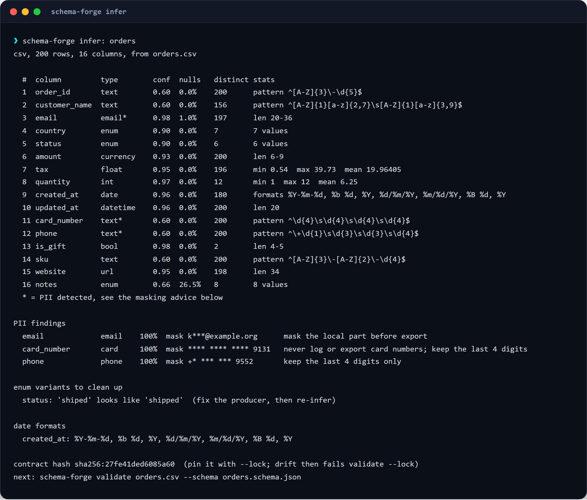
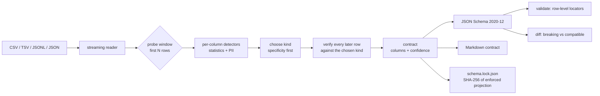

# schema-forge

**Infer a data contract from a messy CSV once, commit it, and let CI fail the moment a producer silently changes a column type.**




## The problem

Data enters a repository from somewhere you do not control: a nightly export, a
vendor SFTP drop, a log dump replayed to disk. Nobody writes down what the
columns are. Then one Tuesday `quantity` starts shipping `n/a` instead of an
integer, `amount` loses its dollar sign, a new `loyalty_tier` column appears,
and three downstream jobs fail twelve hours later with a `ValueError` somewhere
unrelated.

Writing the schema by hand is the obvious fix, and it is also the reason it never
happens: a 40-column export takes an afternoon of squinting at samples, and the
first draft is wrong anyway. **schema-forge reads the data you already have,
infers the contract with an explicit confidence score per column, and turns it
into a versioned artifact you can diff and enforce.** Pure Python, zero runtime
dependencies.

## What it does

- **Infers 12 column types** from real values: `int`, `float`, `bool`, `date`,
  `datetime`, `email`, `url`, `uuid`, `currency`, `enum`, `categorical`, `text`.
  Type choice is specificity-first: an all-integer column beats float, ISO dates
  beat text, and a 7-value column with 200 rows is an enum rather than free text.
- **Scores every column with a decomposed confidence**: the product of fill rate,
  type support (how many values actually matched), type specificity and sample
  depth. `explain` shows each factor separately, so `0.60` is inspectable
  rather than a magic number.
- **Statistics that belong in a contract**: min/max/mean for numerics, min/max
  length, distinct count, null count and null ratio per column.
- **Enum detection with a threshold** (`--enum-threshold`, default 24 distinct
  values and at most 20% of rows) plus **typo variants**: a single `shiped`
  among 140 `shipped` rows is reported as a likely producer bug.
- **Regex pattern induction** for structured text (`^[A-Z]{3}\-[A-Z]{2}\-\d{4}$`).
  A pattern is only emitted when it was re-verified against every sampled value.
- **PII detection** for cards (Luhn), IBANs (mod-97), US SSNs, emails and phones,
  with a deterministic masked example and masking advice per column.
- **Emits three artifacts**: JSON Schema draft 2020-12, a human-readable Markdown
  contract table, and `schema.lock.json` holding a stable SHA-256 over just the
  enforced projection.
- **Validates with row-level locators**: `row 42, column amount: expected pattern
  ^\d+\.\d{2}$, got '12,50'`. Flags: `--strict` (default), `--no-strict`,
  `--max-errors`, `--sample`, `--lock`, `--json`.
- **Diffs two contract versions** and classifies each change as breaking or
  compatible (type widening vs narrowing, required flips, enum shrink, pattern and
  format changes, unknown-column rejection) with migration guidance.
- **Streams.** One pass over the file, bounded per-column counters, no rows kept
  in memory. 50,000 rows x 9 columns in about 2 seconds on a laptop.

## Install

Not on PyPI yet. Install from source:

```bash
git clone https://github.com/kele-tao/schema-forge
cd schema-forge
python -m pip install -e .
schema-forge --version
```

Python 3.10+. No runtime dependencies at all; `pytest` and `ruff` are dev-only.

## Usage

### 1. Infer a contract from a messy export

```console
$ schema-forge infer examples/orders.csv --name orders
schema-forge infer: orders
csv, 200 rows, 16 columns, from orders.csv

  #  column         type        conf  nulls   distinct stats
  1  order_id       text        0.60  0.0%    200      pattern ^[A-Z]{3}\-\d{5}$
  2  customer_name  text        0.60  0.0%    156      pattern ^[A-Z]{1}[a-z]{2,7}\s[A-Z]{1}[a-z]{3,9}$
  3  email          email*      0.98  1.0%    197      len 20-36
  4  country        enum        0.90  0.0%    7        7 values
  5  status         enum        0.90  0.0%    6        6 values
  6  amount         currency    0.93  0.0%    200      len 6-9
  7  tax            float       0.95  0.0%    196      min 0.54  max 39.73  mean 19.96405
  8  quantity       int         0.97  0.0%    12       min 1  max 12  mean 6.25
  9  created_at     date        0.96  0.0%    180      formats %Y-%m-%d, %b %d, %Y, %d/%m/%Y, %m/%d/%Y, %B %d, %Y
  10 updated_at     datetime    0.96  0.0%    200      len 20
  11 card_number    text*       0.60  0.0%    200      pattern ^\d{4}\s\d{4}\s\d{4}\s\d{4}$
  12 phone          text*       0.60  0.0%    200      pattern ^\+\d{1}\s\d{3}\s\d{3}\s\d{4}$
  13 is_gift        bool        0.98  0.0%    2        len 4-5
  14 sku            text        0.60  0.0%    200      pattern ^[A-Z]{3}\-[A-Z]{2}\-\d{4}$
  15 website        url         0.95  0.0%    198      len 34
  16 notes          enum        0.66  26.5%   8        8 values
  * = PII detected, see the masking advice below

PII findings
  email             email    100%  mask k***@example.org      mask the local part before export
  card_number       card     100%  mask **** **** **** 9131   never log or export card numbers; keep the last 4 digits
  phone             phone    100%  mask +* *** *** 9552       keep the last 4 digits only

enum variants to clean up
  status: 'shiped' looks like 'shipped'  (fix the producer, then re-infer)

date formats
  created_at: %Y-%m-%d, %b %d, %Y, %d/%m/%Y, %m/%d/%Y, %B %d, %Y

contract hash sha256:27fe41ded6085a60  (pin it with --lock; drift then fails validate --lock)
next: schema-forge validate orders.csv --schema orders.schema.json
```

Commit the artifacts you want to enforce:

```bash
schema-forge infer examples/orders.csv --name orders \
  --out contract/orders.schema.json \
  --markdown contract/orders.md \
  --lock contract/schema.lock.json
```

### 2. Enforce it in CI (exit code 1 on violations)

```console
$ schema-forge validate examples/orders_drift.csv --schema examples/orders.schema.json --max-errors 4
schema-forge validate: orders_drift.csv against orders.schema.json
120 rows, 120 sampled, 1920 cells checked
lock: ok  schema matches the lock (27fe41ded608)

unknown columns: loyalty_tier
violations (showing 4 of 61):
  x row 2, column loyalty_tier: unknown column (strict mode rejects columns the contract does not declare)
  x row 6, column quantity: expected integer, got 'n/a'
  x row 8, column tax: expected number, got '12,50'
  x row 11, column quantity: expected integer, got 'n/a'
  error collection stopped at --max-errors

FAIL  61 violation(s) across 120 rows
$ echo $?
1
```

`--lock` additionally fails when the schema file was edited without
regenerating the lock: `lock: drift  schema hash ... does not match the lock ...`.

### 3. Diff two contract versions before merging

```console
$ schema-forge diff examples/orders.schema.json examples/orders.drift.schema.json
schema-forge diff: orders -> orders

  BREAKING column-added [loyalty_tier]
           column 'loyalty_tier' is new and required
           fix: backfill the column in every producer before requiring it
  BREAKING type-narrowed [quantity]
           type changed from integer to string for column 'quantity'
           fix: map old values to the new type before switching the contract on
  BREAKING type-narrowed [tax]
           type changed from number to string for column 'tax'
           fix: map old values to the new type before switching the contract on
  compat   enum-grew [country]
           enum on 'country' gained 'br', 'de', 'fr', 'gb', 'in', 'jp'
           fix: downstream switches may need a new branch
  compat   enum-introduced [is_gift]
           an enum was added to column 'is_gift'
           fix: none; the enum lists exactly the values already seen
  compat   type-widened [is_gift]
           type changed from boolean to string for column 'is_gift'
           fix: readers that expected the old type still succeed
  compat   enum-introduced [quantity]
           an enum was added to column 'quantity'
           fix: none; the enum lists exactly the values already seen

3 breaking change(s): this contract breaks existing producers
4 compatible change(s)
```

### 4. Ask why a column got its type

```console
$ schema-forge explain examples/orders.csv --column amount
column 'amount' -> currency
  confidence 0.93  |  200 rows probed, 200 values, 0 empty (0.0%), 200 distinct

confidence is the product of four factors:
  fill rate       non-empty values / rows seen        1.000
  type support    values matching the chosen type     1.000
  specificity     how specific the chosen type is     0.930
  sample depth    how many values backed the call     1.000

candidates considered on the probe sample:
  currency     1.000  (200/200 values)

evidence rows:
  row 2    '$3,417.77'                    matched currency
  row 3    '$2,202.49'                    matched currency
  row 4    '$3,016.63'                    matched currency

stats: min_length=6, max_length=9, distinct=200, filled=200
rows in source: 200
```

`explain --schema contract/orders.schema.json --column amount` reads the
evidence baked into the schema, so it works in CI where re-inferring is unwanted.

### Exit codes

| Code | Meaning |
| --- | --- |
| 0 | success |
| 1 | findings: validation violations, a breaking diff, or lock drift |
| 2 | usage error: bad flags, unreadable input, malformed schema |

## How it works



Inference is two phases over a single streaming pass. The **probe window**
(`--probe-rows`, default 2000) collects every candidate match for every value and
picks the most specific type whose matcher accepted *all* of them. The rest of the
file is the **verification phase**: each later value is checked against the chosen
type and mismatches are counted. That is what makes the confidence number mean
something: it is not "the first 2000 rows looked like this", it is "99.8% of the
rows matched". A column whose verification support drops can never report full
confidence, and the mismatching values are quoted in the schema note.

The **contract hash** is a SHA-256 over a canonical JSON projection of only the
enforced keywords (`type`, `format`, `pattern`, `enum`, `required`,
`additionalProperties`) with sorted keys. Statistics, confidence and evidence are
deliberately excluded, so re-inferring the same shape from a bigger batch does not
change the hash and does not page anyone. Renaming a column or widening an integer
to a number does.

Validation is a separate, schema-driven path: it reads the JSON Schema (only the
keywords listed below), walks rows in the same streaming fashion, and reports the
first failure per cell with a locator. It never re-infers anything, so CI cannot
drift from what you committed.

## Design decisions

**1. Confidence is a product, not a heuristic.** The four factors (fill rate, type
support, specificity, sample depth) multiply into the reported 0.00-1.00 and every
factor is stored in the schema next to it. A product means a column with 40% nulls
can never show 0.99 even if every non-null value is a perfect email. The tradeoff:
the number is conservative, and a `text` column can never score above 0.60,
because "we could not find structure" genuinely is low confidence.

**2. The lock hash covers intent, not evidence.** Hashing the whole schema
(including stats and evidence rows) would make the lock flap every time you
re-infer on a new batch, which trains people to ignore it. Hashing only the
enforced projection means the lock changes exactly when the contract changes. The
tradeoff: the hash alone does not tell a reviewer whether the *evidence* changed,
so `explain` and the committed Markdown contract carry that.

**3. One streaming pass with a bounded probe instead of two full passes.** Two
passes would give exact type statistics over the whole file, but double the I/O on
500 MB exports and make the tool awkward to pipe. A bounded probe plus full-file
verification gets nearly all of the value for one pass; the tail mismatch count is
surfaced as a note and in `--json`, so a late type change is loud rather than
invisible. If a column changes type only in the last 1% of a 10M-row file, the
contract keeps the old type but the confidence and the note tell you.

## Performance

Generated by `python benchmarks/run.py` (best of 3, warm cache, input generated by
the script itself with a fixed seed). Full report: [docs/benchmark.md](docs/benchmark.md).

| Operation | Rows | Input (MB) | Best (s) | Rows/s |
| --- | --- | --- | --- | --- |
| infer | 1,000 | 0.10 | 0.173 | 5,767 |
| validate | 1,000 | 0.10 | 0.026 | 38,973 |
| infer | 10,000 | 0.97 | 0.624 | 16,026 |
| validate | 10,000 | 0.97 | 0.326 | 30,663 |
| infer | 50,000 | 4.91 | 1.981 | 25,246 |
| validate | 50,000 | 4.91 | 1.625 | 30,776 |

Diffing two 9-column contracts: **42.0 microseconds**, classifying 1 change.
Peak Python allocation while streaming a 10 MB / 50,000-row file: **3.77 MB**
(tracemalloc; memory stays flat because only bounded per-column counters are kept).

## Comparison

| Tool | What it does better | What schema-forge does differently |
| --- | --- | --- |
| Hand-written JSON Schema + `jsonschema` | Full JSON Schema support, decades of edge cases, validators in every language. | You still have to write the schema, and `jsonschema` has no notion of inference, confidence, PII or lock files. schema-forge emits a document `jsonschema` can read too. |
| Great Expectations | Far more expectation types, a data-docs UI, checkpoint orchestration, a real community. | Heavy dependency tree and a suite you author by hand. schema-forge is one `pip install -e .` with zero runtime deps and infers the first draft for you. |
| pandera | Dataframe-native schemas, tight pandas/polars integration, runtime type checks. | Requires pandas and lives inside Python. schema-forge is file-and-CLI first, so it drops into any language's CI job as one step. |
| csvkit / csvlint | Tiny, fast, good at CSV mechanics. | They check CSV structure, not column-level types, enums, PII or contract drift. |

schema-forge is deliberately not a full JSON Schema implementation: it supports
exactly the subset it emits (`type`, `format`, `pattern`, `enum`, `required`,
`additionalProperties`). `jsonschema` is still the right tool when you need
`anyOf`, `$ref` and remote resolution.

## Roadmap

See [docs/ROADMAP.md](docs/ROADMAP.md). Next up: Parquet/Arrow input, a
`--baseline` mode that only fails on *new* violations, per-column override files,
and `validate --explain` which prints inferred-vs-actual for a failing column.

## Contributing

Issues and PRs are welcome; read [CONTRIBUTING.md](CONTRIBUTING.md) first. Every
number in this README is reproducible with the commands above, and PRs that change
numbers must regenerate them with `python benchmarks/run.py`.

## License

MIT. See [LICENSE](LICENSE).