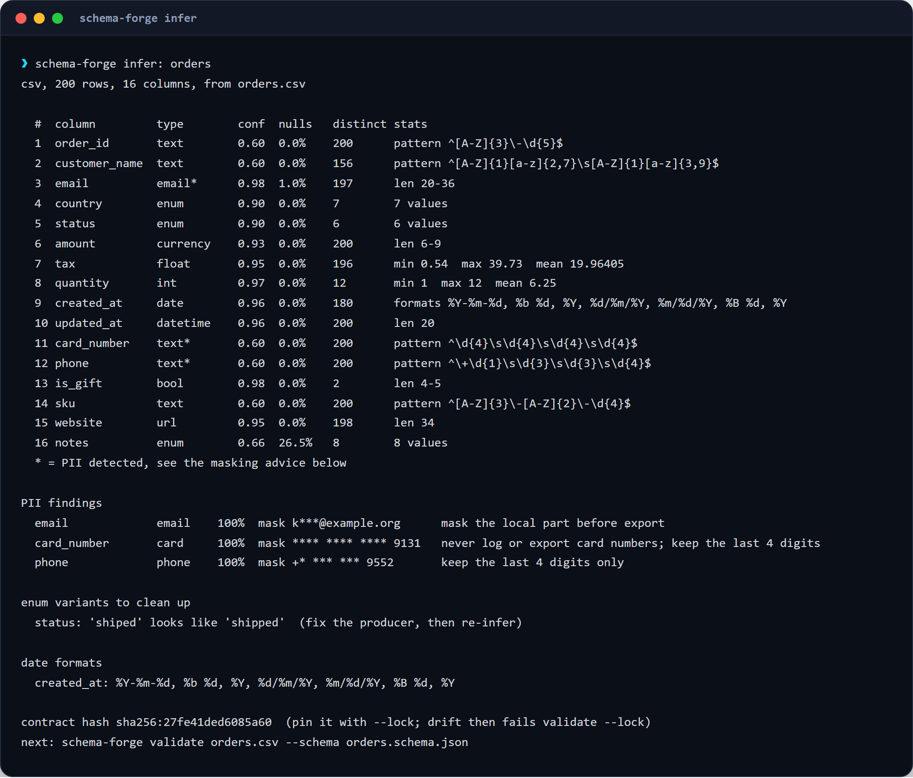
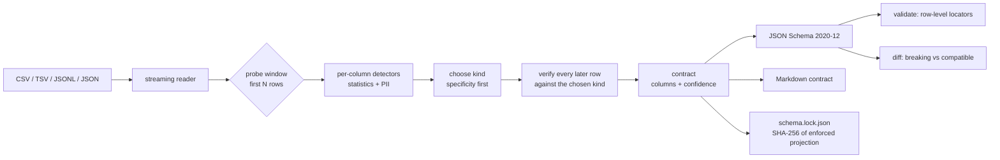

# schema-forge

[English](README.md) | **简体中文**

**从一个杂乱的 CSV 里推断一次数据契约，把它提交进仓库，之后只要上游生产者悄悄改掉某一列的类型，CI 就会立刻失败。**




## 问题

数据总是从你控制不了的地方进入仓库：一个每晚跑的导出任务、供应商通过 SFTP
投放的文件、被重新落盘的一份日志转储。没有人把列的含义写下来。然后某个周二，
`quantity` 开始给出 `n/a` 而不是整数，`amount` 丢掉了美元符号，冒出一个新的
`loyalty_tier` 列，十二个小时之后三个下游作业挂掉，而报错的地方看起来毫不相关，
只抛了一个 `ValueError`。

手写 schema 是显而易见的解法，也正是它一直没人做的原因：一个 40 列的导出文件，
光是盯着样本眯眼看就要花掉一下午，而且第一版往往还是错的。**schema-forge 读取你
手上已有的数据，为每一列推断契约并给出明确的置信度，再把它变成可以 diff、可以在
CI 里强制执行的版本化产物。** 纯 Python，零运行时依赖。

## 它能做什么

- **从真实值中推断 12 种列类型**：`int`、`float`、`bool`、`date`、
  `datetime`、`email`、`url`、`uuid`、`currency`、`enum`、`categorical`、`text`。
  类型选择以“具体优先”：全整数列不会被判成 float，ISO 日期不会被判成 text，
  只有 7 个取值却占了 200 行的列会被判成 enum，而不是自由文本。
- **为每一列给出可拆解的置信度**：置信度是填充率、类型支持度（有多少值真的匹配）、
  类型具体程度和样本深度四项的乘积。`explain` 会把每个因子单独列出来，
  于是 `0.60` 是可以检查的，而不是一个魔法数字。
- **契约该有的统计量**：数值列的 min/max/mean，长度的最小/最大值，去重计数，
  空值计数和空值比例。
- **带阈值的枚举检测**（`--enum-threshold`，默认 24 个不同取值、且至多占 20% 的行），
  外加**拼写变体**：140 行 `shipped` 里冒出一个 `shiped`，会被报告为疑似上游 bug。
- **正则模式归纳**，面向结构化文本（`^[A-Z]{3}\-[A-Z]{2}\-\d{4}$`）。
  只有把模式回验过每一个采样值之后，才会输出它。
- **PII 检测**：银行卡（Luhn 校验）、IBAN（mod-97 校验）、美国 SSN、邮箱和电话，
  并为每一列给出确定性的脱敏示例和脱敏建议。
- **产出三类产物**：JSON Schema draft 2020-12、一份人类可读的 Markdown 契约表格，
  以及 `schema.lock.json`——它只对被强制执行的那部分投影计算一个稳定的 SHA-256。
- **带行级定位的校验**：`row 42, column amount: expected pattern
  ^\d+\.\d{2}$, got '12,50'`。相关 flag：`--strict`（默认）、`--no-strict`、
  `--max-errors`、`--sample`、`--lock`、`--json`。
- **对比两个契约版本**，把每处变化归类为破坏性或不破坏兼容（类型放宽 vs 收窄、
  required 翻转、枚举收缩、pattern 与 format 变化、拒绝未知列），并给出迁移建议。
- **流式处理。** 对文件只扫一遍，每列只保留有界计数器，内存里不留任何行。
  在笔记本上，50,000 行 x 9 列大约耗时 2 秒。

## 安装

尚未发布到 PyPI，请从源码安装：

```bash
git clone https://github.com/kele-tao/schema-forge
cd schema-forge
python -m pip install -e .
schema-forge --version
```

Python 3.10+。完全零运行时依赖；`pytest` 和 `ruff` 只在开发时使用。

## 用法

### 1. 从一个杂乱的导出文件推断契约

```console
$ schema-forge infer examples/orders.csv --name orders
schema-forge infer: orders
csv, 200 rows, 16 columns, from orders.csv

  #  column         type        conf  nulls   distinct stats
  1  order_id       text        0.60  0.0%    200      pattern ^[A-Z]{3}\-\d{5}$
  2  customer_name  text        0.60  0.0%    156      pattern ^[A-Z]{1}[a-z]{2,7}\s[A-Z]{1}[a-z]{3,9}$
  3  email          email*      0.98  1.0%    197      len 20-36
  4  country        enum        0.90  0.0%    7        7 values
  5  status         enum        0.90  0.0%    6        6 values
  6  amount         currency    0.93  0.0%    200      len 6-9
  7  tax            float       0.95  0.0%    196      min 0.54  max 39.73  mean 19.96405
  8  quantity       int         0.97  0.0%    12       min 1  max 12  mean 6.25
  9  created_at     date        0.96  0.0%    180      formats %Y-%m-%d, %b %d, %Y, %d/%m/%Y, %m/%d/%Y, %B %d, %Y
  10 updated_at     datetime    0.96  0.0%    200      len 20
  11 card_number    text*       0.60  0.0%    200      pattern ^\d{4}\s\d{4}\s\d{4}\s\d{4}$
  12 phone          text*       0.60  0.0%    200      pattern ^\+\d{1}\s\d{3}\s\d{3}\s\d{4}$
  13 is_gift        bool        0.98  0.0%    2        len 4-5
  14 sku            text        0.60  0.0%    200      pattern ^[A-Z]{3}\-[A-Z]{2}\-\d{4}$
  15 website        url         0.95  0.0%    198      len 34
  16 notes          enum        0.66  26.5%   8        8 values
  * = PII detected, see the masking advice below

PII findings
  email             email    100%  mask k***@example.org      mask the local part before export
  card_number       card     100%  mask **** **** **** 9131   never log or export card numbers; keep the last 4 digits
  phone             phone    100%  mask +* *** *** 9552       keep the last 4 digits only

enum variants to clean up
  status: 'shiped' looks like 'shipped'  (fix the producer, then re-infer)

date formats
  created_at: %Y-%m-%d, %b %d, %Y, %d/%m/%Y, %m/%d/%Y, %B %d, %Y

contract hash sha256:27fe41ded6085a60  (pin it with --lock; drift then fails validate --lock)
next: schema-forge validate orders.csv --schema orders.schema.json
```

把你想强制执行的产物提交进仓库：

```bash
schema-forge infer examples/orders.csv --name orders \
  --out contract/orders.schema.json \
  --markdown contract/orders.md \
  --lock contract/schema.lock.json
```

### 2. 在 CI 中强制执行（违规时退出码为 1）

```console
$ schema-forge validate examples/orders_drift.csv --schema examples/orders.schema.json --max-errors 4
schema-forge validate: orders_drift.csv against orders.schema.json
120 rows, 120 sampled, 1920 cells checked
lock: ok  schema matches the lock (27fe41ded608)

unknown columns: loyalty_tier
violations (showing 4 of 61):
  x row 2, column loyalty_tier: unknown column (strict mode rejects columns the contract does not declare)
  x row 6, column quantity: expected integer, got 'n/a'
  x row 8, column tax: expected number, got '12,50'
  x row 11, column quantity: expected integer, got 'n/a'
  error collection stopped at --max-errors

FAIL  61 violation(s) across 120 rows
$ echo $?
1
```

当 schema 文件被改动却没有重新生成锁文件时，`--lock` 还会额外失败：
`lock: drift  schema hash ... does not match the lock ...`。

### 3. 合并前对比两个契约版本

```console
$ schema-forge diff examples/orders.schema.json examples/orders.drift.schema.json
schema-forge diff: orders -> orders

  BREAKING column-added [loyalty_tier]
           column 'loyalty_tier' is new and required
           fix: backfill the column in every producer before requiring it
  BREAKING type-narrowed [quantity]
           type changed from integer to string for column 'quantity'
           fix: map old values to the new type before switching the contract on
  BREAKING type-narrowed [tax]
           type changed from number to string for column 'tax'
           fix: map old values to the new type before switching the contract on
  compat   enum-grew [country]
           enum on 'country' gained 'br', 'de', 'fr', 'gb', 'in', 'jp'
           fix: downstream switches may need a new branch
  compat   enum-introduced [is_gift]
           an enum was added to column 'is_gift'
           fix: none; the enum lists exactly the values already seen
  compat   type-widened [is_gift]
           type changed from boolean to string for column 'is_gift'
           fix: readers that expected the old type still succeed
  compat   enum-introduced [quantity]
           an enum was added to column 'quantity'
           fix: none; the enum lists exactly the values already seen

3 breaking change(s): this contract breaks existing producers
4 compatible change(s)
```

### 4. 追问某一列为什么被判定成这个类型

```console
$ schema-forge explain examples/orders.csv --column amount
column 'amount' -> currency
  confidence 0.93  |  200 rows probed, 200 values, 0 empty (0.0%), 200 distinct

confidence is the product of four factors:
  fill rate       non-empty values / rows seen        1.000
  type support    values matching the chosen type     1.000
  specificity     how specific the chosen type is     0.930
  sample depth    how many values backed the call     1.000

candidates considered on the probe sample:
  currency     1.000  (200/200 values)

evidence rows:
  row 2    '$3,417.77'                    matched currency
  row 3    '$2,202.49'                    matched currency
  row 4    '$3,016.63'                    matched currency

stats: min_length=6, max_length=9, distinct=200, filled=200
rows in source: 200
```

`explain --schema contract/orders.schema.json --column amount` 读取的是烘进 schema
里的证据，所以在不适合重新推断的 CI 环境里同样能用。

### 退出码

| 退出码 | 含义 |
| --- | --- |
| 0 | 成功 |
| 1 | 有发现：校验违规、破坏性 diff，或锁文件漂移 |
| 2 | 用法错误：错误的 flag、无法读取的输入、格式不合法的 schema |

## 工作原理



推断是在一遍流式扫描上分两个阶段完成的。**探测窗口**（`--probe-rows`，默认 2000）
会收集每个值的所有候选匹配，然后选出“匹配器接受了全部值”的最具体类型。文件剩下的
部分属于**验证阶段**：后续每个值都会按选定的类型检查，不匹配的值被计数。这正是
置信度有意义的原因——它表达的不是“前 2000 行长这样”，而是“99.8% 的行都匹配”。
验证阶段支持度掉下去的列，永远不可能报出满置信度，而那些不匹配的值会被引用到
schema 的 note 里。

**契约哈希**是对一份规范化 JSON 投影计算的 SHA-256，这份投影只包含被强制执行的
关键字（`type`、`format`、`pattern`、`enum`、`required`、`additionalProperties`），
并且键已排序。统计量、置信度和证据被刻意排除在外，所以换一个更大的批次重新推断同样
的形状不会改变哈希，也就不会半夜把人叫起来。而重命名一列，或者把整数放宽成数字，
就会改变哈希。

校验是一条独立的、由 schema 驱动的路径：它读取 JSON Schema（只读下面列出的关键字），
用同样的流式方式遍历行，并以定位符报告每个单元格的第一个失败。它从不重新推断任何
东西，所以 CI 不可能和你提交的契约产生漂移。

## 设计取舍

**1. 置信度是乘积，不是启发式。** 四个因子（填充率、类型支持度、具体程度、样本深度）
相乘得到报告的 0.00-1.00，每个因子都和它一起存进 schema。用乘积意味着：即使每个
非空值都是完美的邮箱，一列只要有 40% 的空值，就永远显示不了 0.99。取舍是：这个
数字偏保守，`text` 列的得分永远不会超过 0.60，因为“我们找不到结构”确实就是低
置信度。

**2. 锁哈希覆盖的是意图，不是证据。** 如果对整个 schema（包括统计量和证据行）做哈希，
那么每次在新批次上重新推断，锁都会抖一下，而这只会训练人们忽略它。只对被强制执行的
投影做哈希，锁就恰好在契约发生变化时变化。取舍是：单看哈希无法告诉评审者*证据*有
没有变，这部分由 `explain` 和提交进仓库的 Markdown 契约承担。

**3. 一次流式扫描加有界探测，而不是两次完整扫描。** 两次扫描能给出整份文件上的精确
类型统计，但在 500 MB 的导出文件上会让 I/O 翻倍，也让工具不好接管道。有界探测加上
全文件验证，用一次扫描拿到了几乎全部价值；尾部的失配计数会以 note 和 `--json` 的
形式露出来，于是后期的类型变化是响亮的，而不是隐形的。如果某一列只在 10M 行文件的
最后 1% 处改变类型，契约会保留旧类型，但置信度和 note 会告诉你。

## 性能与基准测试

由 `python benchmarks/run.py` 生成（3 次取最好、预热缓存、输入由脚本自身以固定种子
生成）。完整报告见 [docs/benchmark.md](docs/benchmark.md)。

| 操作 | 行数 | 输入（MB） | 最好成绩（秒） | 行/秒 |
| --- | --- | --- | --- | --- |
| infer | 1,000 | 0.10 | 0.173 | 5,767 |
| validate | 1,000 | 0.10 | 0.026 | 38,973 |
| infer | 10,000 | 0.97 | 0.624 | 16,026 |
| validate | 10,000 | 0.97 | 0.326 | 30,663 |
| infer | 50,000 | 4.91 | 1.981 | 25,246 |
| validate | 50,000 | 4.91 | 1.625 | 30,776 |

对比两个 9 列契约：**42.0 微秒**，判定了 1 处变化。流式处理一个 10 MB / 50,000 行的
文件时，Python 峰值分配为 **3.77 MB**（tracemalloc；内存保持平坦，因为只保留了每列
的有界计数器）。

## 对比

| 工具 | 它做得更好的地方 | schema-forge 的不同之处 |
| --- | --- | --- |
| 手写 JSON Schema + `jsonschema` | 完整的 JSON Schema 支持，多年积累的边界情况，每种语言都有校验器。 | 你还是得自己写 schema，而且 `jsonschema` 没有推断、置信度、PII 或锁文件的概念。schema-forge 产出的文档 `jsonschema` 也能读。 |
| Great Expectations | 多得多的期望类型、数据文档 UI、检查点编排、真正的社区。 | 依赖树重，套件还得手写。schema-forge 只要一次 `pip install -e .`，零运行时依赖，还替你推断好第一版。 |
| pandera | 面向 DataFrame 的 schema，与 pandas/polars 紧密集成，运行时类型检查。 | 需要 pandas，而且活在 Python 内部。schema-forge 以文件和 CLI 为先，所以作为一步就能塞进任何语言的 CI 作业。 |
| csvkit / csvlint | 小而快，擅长 CSV 机制层面的东西。 | 它们检查 CSV 结构，而不是列级类型、枚举、PII 或契约漂移。 |

schema-forge 刻意不做完整的 JSON Schema 实现：它只支持自己会产出的那个子集
（`type`、`format`、`pattern`、`enum`、`required`、`additionalProperties`）。
当你需要 `anyOf`、`$ref` 和远程解析时，`jsonschema` 仍然是正确的工具。

## 路线图

见 [docs/ROADMAP.md](docs/ROADMAP.md)。接下来是：Parquet/Arrow 输入、一个只在
*新增* 违规时才失败的 `--baseline` 模式、每列覆盖文件，以及 `validate --explain`
——它为失败的列打印推断值与实际值。

## 参与贡献

欢迎 issue 和 PR，动手前请先读 [CONTRIBUTING.md](CONTRIBUTING.md)。本 README 里的
每个数字都能用上面的命令复现，改动数字的 PR 必须用 `python benchmarks/run.py`
重新生成。

## 许可证

MIT。见 [LICENSE](LICENSE)。
