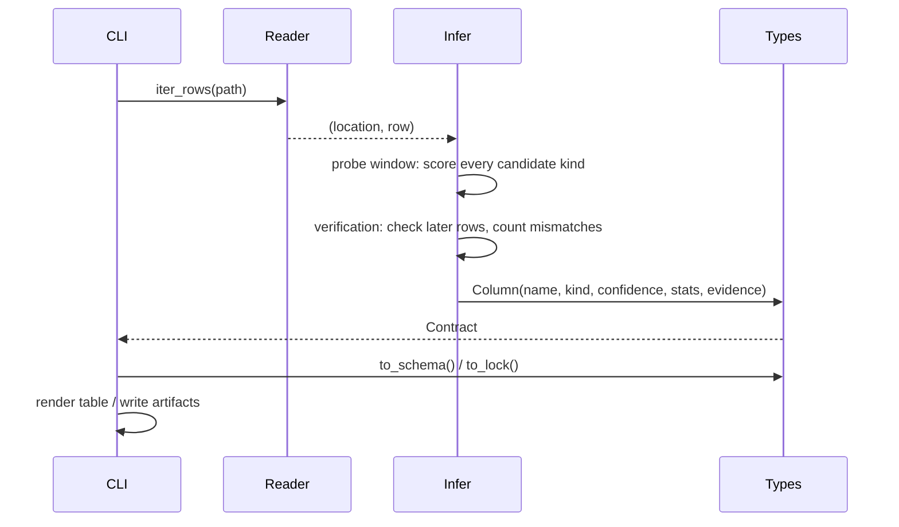

# Architecture

schema-forge is about 2,000 lines of Python across seven modules. Each module
owns exactly one idea, and none of them import the CLI.

```
src/schema_forge/
  detect.py    pure value matchers: int, float, bool, date, datetime, email,
               url, uuid, currency; PII checks (Luhn, IBAN mod-97, SSN, phone);
               regex induction. No I/O.
  types.py     the data model (Column, Contract, Pii, Candidate, Evidence) and
               the JSON Schema / lock-file emitters. Knows nothing about rows.
  reader.py    streaming CSV / TSV / JSONL / JSON readers that yield
               (location, row) with a locator string. The only module that
               understands file formats.
  infer.py     the engine: probe window, verification pass, type choice,
               confidence decomposition, enum typo detection.
  validate.py  schema loading + row-level validation against the enforced
               subset, plus lock comparison.
  diff.py      semantic comparison of two SchemaSpec values, classifying each
               change as breaking or compatible with migration guidance.
  report.py    presentation only: the infer table, explain report, Markdown
               contract, validate report. Takes plain data, returns strings.
  cli.py       argparse wiring, exit codes, error translation. The only module
               that writes to stdout.
```

## Data flow



## Why the probe and verify split exists

A single pass cannot know the final type before it has seen every value, and two
passes double the I/O. The split fixes both: type choice uses the first
`--probe-rows` rows (default 2000), and the rest of the file verifies that
choice, counting matches and keeping up to `--evidence-rows` mismatches per
column. Confidence's `type_support` factor is exactly that verification ratio,
so a late type change lowers confidence instead of being silently ignored.

Bounded memory follows from the same design: an `Accumulator` holds counters,
a capped distinct set (`--max-distinct`, default 5000), a capped pattern sample
(300 values) and up to 5 evidence rows. Rows are never retained.

## The enforced subset

```
type, format, pattern, enum, required, additionalProperties
```

This is deliberately closed. `load_schema` rejects documents that use a format
or type it does not implement, so a contract never silently loses a constraint.
If you need `anyOf` or `$ref`, use `jsonschema` against the same file: the
document is standard draft 2020-12 with one `x-schema-forge` extension keyword.

## Determinism rules

- Column order follows first appearance in the input.
- Enum values are sorted by count descending, then value ascending.
- Candidates are sorted by count descending, then kind ascending.
- The contract hash is SHA-256 over canonical JSON (sorted keys, no spaces) of
  the enforced projection only.
- No timestamps, hostnames or absolute paths are written into the schema.
